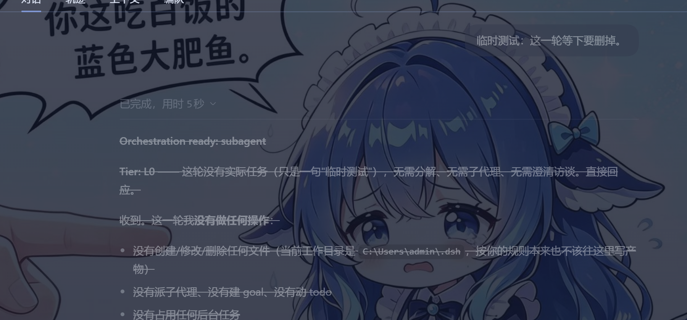
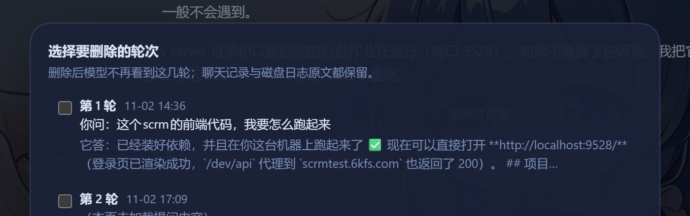
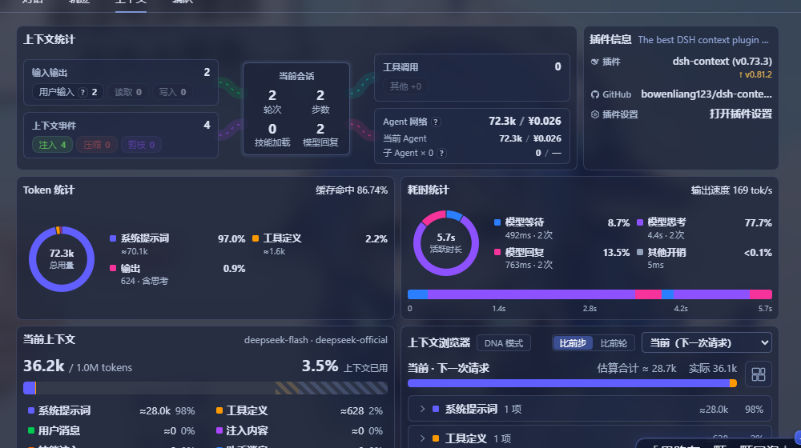

# DSH 会话轮次删除（turn-delete）

给 [DSH（DeepSeek Harness）](https://github.com/1772538871/dsh-proto) 用的插件：
**勾选会话里的某几轮问答，把它们从"模型能看到的历史"里删掉**——聊天记录和磁盘日志的原文仍然保留。

它不是"改显示"，而是改**模型实际收到的上下文**：删掉的轮次之后不会再出现在任何一次请求里，
不占 token、不干扰注意力。相当于手动把上下文整理干净。



---

## 30 秒装好：让 AI 帮你装

> 这一节是给"不想碰命令行、不想看原理"的人准备的。详细步骤和排错见 **[INSTALL.md](INSTALL.md)**。

把下面整段复制给你的 AI（**DSH 自带的 Agent 最好用**，因为它能直接调 `plugin_manager`）：

```text
请帮我安装一个 DSH 插件 dsh-turn-delete，按这个流程，不要跳步：

1. 找到本机仓库里的插件目录 dsh-turn-delete-plugin（里面应有 package.json、index.js、
   client.js、cordis.patch.yml）。如果本机还没有这个仓库，先：
   git clone https://github.com/1772538871/dsh-proto
   （克隆到合适的位置，不要放系统目录。）

2. 拿到该目录的绝对路径后执行：
   plugin_manager(action="install_bundle", target="<那个绝对路径>")

3. 读返回值：application == "applied" 且 enabled == true 才算成功；否则把 error /
   warnings / nextStep 原文贴给我，不要自己猜着改。

4. 成功后调用 plugin_manager(action="list_plugins")，确认 entryId 为
   include:dsh-turn-delete 的行 enabled: true。

5. 最后告诉我：装到了哪个 profile、我要按什么键刷新页面、刷新后右上角应该看到什么按钮。
```

装完按 **Ctrl+F5** 刷新，会话右上角（文件夹图标左边）出现「**选择对话**」就是装好了。

---

## 目录

- [效果](#效果)
- [怎么用](#怎么用)
- [它是怎么工作的](#它是怎么工作的)
- [会删除什么、不会删除什么](#会删除什么不会删除什么)
- [安装（手动 / 排错）](#安装手动--排错)
- [附带工具（谨慎使用）](#附带工具谨慎使用)
- [仓库结构](#仓库结构)
- [许可](#许可)

---

## 效果

### 1. 选择要删除的轮次

点会话右上角的「选择对话」，弹窗按顺序列出**这个会话的全部轮次**（不是只列最近几轮）：
轮号、时间、你当时问的原话、模型回答的开头。勾选要删的几轮即可。



### 2. 删除后的样子

被删掉的那一轮：**整轮变浅 + 正文加删除线**，轮尾出现「已从上下文移除」标签；
其他轮次完全不受影响，亮度正常、可以继续正常对话。


### 3. 模型确实看不到了

打开「上下文」标签页：被删那轮的用户消息、助手消息都变成 **0 项**，系统提示词原样保留。



---

## 怎么用

### 图形界面

1. 打开任意会话 → 右上角「**选择对话**」；
2. 弹窗里勾选要删的轮次（可多选）；
3. 点「**删除 N 轮**」。

- **成功**：弹窗关闭，头部出现「已移除第 N 轮（模型此后看不到，日志原文保留）」，
  聊天里该轮变浅加删除线，并留下一条 `turn-delete` 命令回执；
- **失败**：弹窗**不会关**，底部用红字写明原因（例如"第 N 轮已经不在模型视野里了"）。

### 命令行

在输入框直接敲：

```text
/turn-delete 2          # 删第 2 轮
/turn-delete 2,3        # 删第 2、3 轮
/turn-delete 5-7        # 删第 5 到第 7 轮
```

---

## 它是怎么工作的

DSH 把"历史"分成两套东西：

| | 是什么 | 谁在看 |
|---|---|---|
| **会话日志** | 只追加的事件流（`session.vN.jsonl.zstd`，seq 连续、永不改写） | 记录、导出、审计 |
| **surface** | 日志里"会变成模型消息"的那部分节点，按顺序折叠 | 每次请求的 messages |

插件做的事情就是往日志末尾追加一条 **surface 替换记录**
（`system/message` + `surfaceOp:{op:'replace', startSeq, endSeq}`）：
把这一轮的节点从 surface 里遮蔽掉。日志原文一条不少，模型从此看不到它。

这个机制不是黑科技——**DSH 自己的 `/compact` 用的就是同一套**。

> 为什么聊天记录不消失？因为聊天页是从**事件流**装配的，不是从 surface 装配的，
> 而且插件的渲染契约只允许"加行"，不允许隐藏别人的行。所以视觉上是"变浅 + 删除线"，
> 语义上是"已经不在上下文里"。

更完整的原理与实测记录见 [删除对话-方案分析.md](删除对话-方案分析.md)。

---

## 会删除什么、不会删除什么

**会从模型视野里消失（整轮一起）**：

- 这一轮你说的话（含这一轮的 system-reminder 等注入）
- 模型这一轮的回答（含回答里内嵌的工具调用）
- 这一轮的工具执行结果

**不会变的**：

- 聊天记录（仍然可见，只是变浅加删除线）
- 磁盘日志原文（导出会话仍然能看到全文）
- 其他轮次、系统提示词
- 附件文件本身

**三种"内容可能绕回来"的情况**：

1. 后续轮次里模型复述过被删内容——那属于后面那条消息；
2. 注入型上下文（`system-reminder`、AGENTS.md 快照、压缩摘要）里包含该内容；
3. **人机信息差**：界面上你还看得见、模型已经看不见。你说"你刚才说的那个"，
   它会真的不知道——这是软删除最容易踩的坑，不是幻觉。

---

## 安装（手动 / 排错）

一条命令的版本：

```text
plugin_manager(action="install_bundle", target="<插件目录的绝对路径>")
```

然后 **Ctrl+F5**。`target` 指向**目录**，里面必须能直接看到 `package.json`。

| 现象 | 怎么办 |
|---|---|
| 装好了但页面没有按钮 | Ctrl+F5；再 `list_plugins` 确认 `include:dsh-turn-delete` 是 `enabled: true` |
| `application: "failed"` | 把 `error` + `nextStep` 原文贴给 AI |
| `restart-required` | 重启 DSH |
| 有按钮但点了没反应 | 看弹窗底部红字 |

完整版（含给 AI 的提示词、五种失败排查、卸载、改代码后怎么生效）见 **[INSTALL.md](INSTALL.md)**。

---

## 附带工具（谨慎使用）

`tools/` 里两个脚本是**离线会话手术**工具，用于"连磁盘原文一起清掉"的场景。
它们直接操作会话日志文件，**不属于日常使用**，请先读
[删除对话-方案分析.md](删除对话-方案分析.md) 第 5 节了解风险。

### `session-surgery.mjs` —— 物理删除某几轮（重建会话日志）

```bash
node tools/session-surgery.mjs <会话目录> <轮次>          # dry-run：只校验，不写盘
node tools/session-surgery.mjs <会话目录> <轮次> --apply   # 备份后落盘
```

它会重排 `seq`、重映射所有引用，然后跑六项校验（连续性 / surface 折叠 / 工具配对 /
turn-step 配对 / 引用完整性 / 用 DSH 引擎派生）。

> ⚠️ **不要在会话还开着的时候对同一个会话 `--apply`**：DSH 进程把会话握在内存里，
> 磁盘被改写后它再追加会写出错位的 seq，造成真正的损坏。必须让该会话未被加载（或重启 DSH 后）再操作。

### `repair-refs.mjs` —— 修复畸形的 `sourceEventSeqs`

```bash
node tools/repair-refs.mjs <会话目录>          # 只检查
node tools/repair-refs.mjs <会话目录> --apply   # 备份后修复
```

只重写替换节点的 `sourceEventSeqs`（改成实际的遮蔽集合），不动 seq、不删事件。
用于修复早期版本插件把该字段写成嵌套数组（`[[8,12],20]`）导致的"重启后会话加载失败"。

---

## 仓库结构

```
dsh-turn-delete-plugin/     插件本体（就是安装这个目录）
  index.js                  宿主端：/turn-delete 命令、surface 替换、校验
  client.js                 浏览器端：选择弹窗、每轮标记、变浅+删除线样式
  package.json              插件清单（dsh.bundle.patch / dsh.client）
  cordis.patch.yml          Loader 装载补丁
  locale/{zh,en}.json       插件管理页显示的名称与描述
  icon.svg                  插件图标
  说明.txt                  中文文件说明（逐个文件讲清楚）
tools/
  session-surgery.mjs       物理重建工具（默认 dry-run）
  repair-refs.mjs           引用修复工具
docs/images/                README 用的效果截图
INSTALL.md                  安装指南（重点：怎么让 AI 帮你装）
删除对话-方案分析.md         底层原理、方案对比、实测结论与事故记录
dsh-chat-delete-prototype.html  最初的交互原型（纯静态页面）
```

---

## English

A DSH plugin that soft-deletes whole conversation turns from the **model-visible history**:
it appends a `surfaceOp: {op:'replace'}` record so the shadowed turns never enter a request
again, while the transcript and the on-disk log keep every original event. Deleted turns are
rendered dimmed with a strikethrough and an "Removed from context" chip.

**Install:** clone this repo, then have your agent run
`plugin_manager(action="install_bundle", target="<absolute path to dsh-turn-delete-plugin>")`
and reload the page. See [INSTALL.md](INSTALL.md) for the copy-paste prompt.
**Use:** 「选择对话」→ pick turns → 「删除 N 轮」, or type `/turn-delete 2,3` in the composer.

---

## 许可

MIT，见 [LICENSE](LICENSE)。
